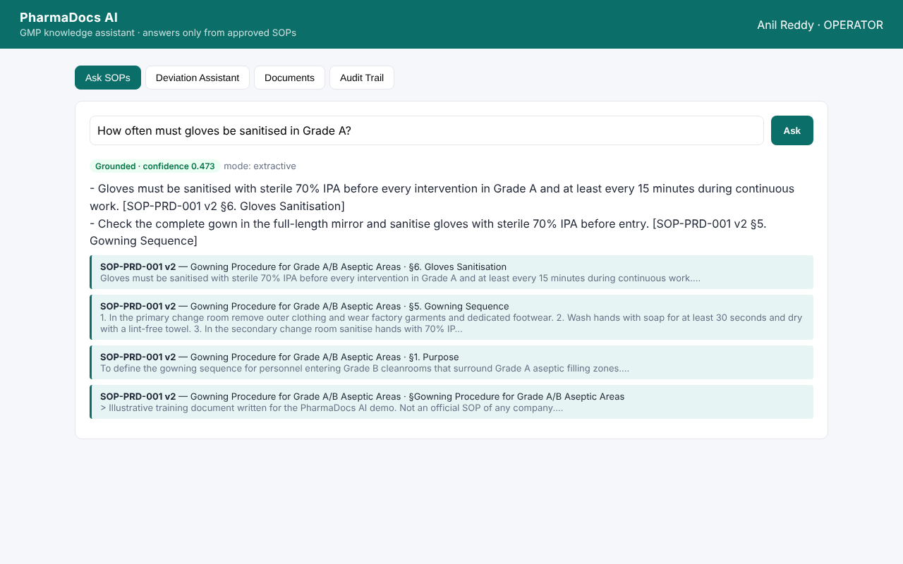
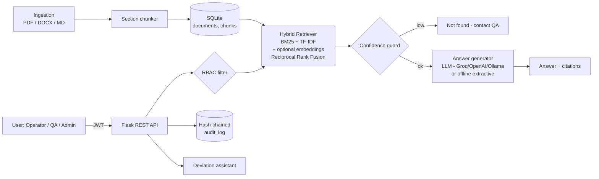
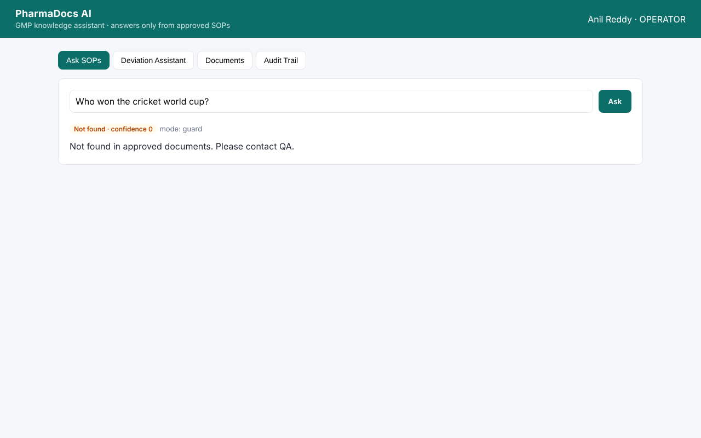
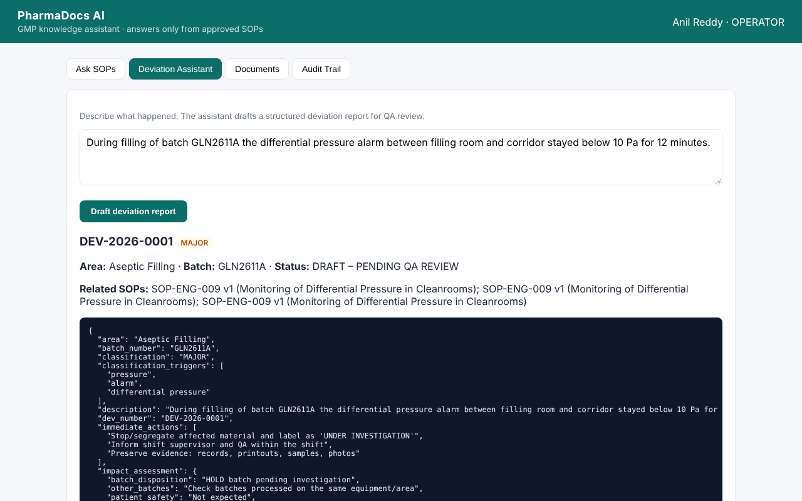
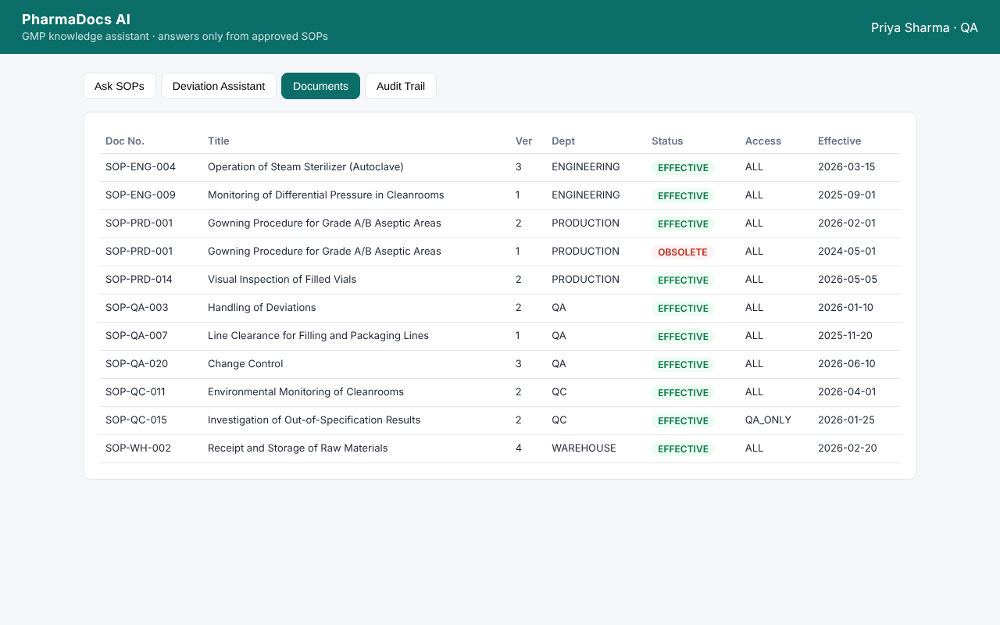
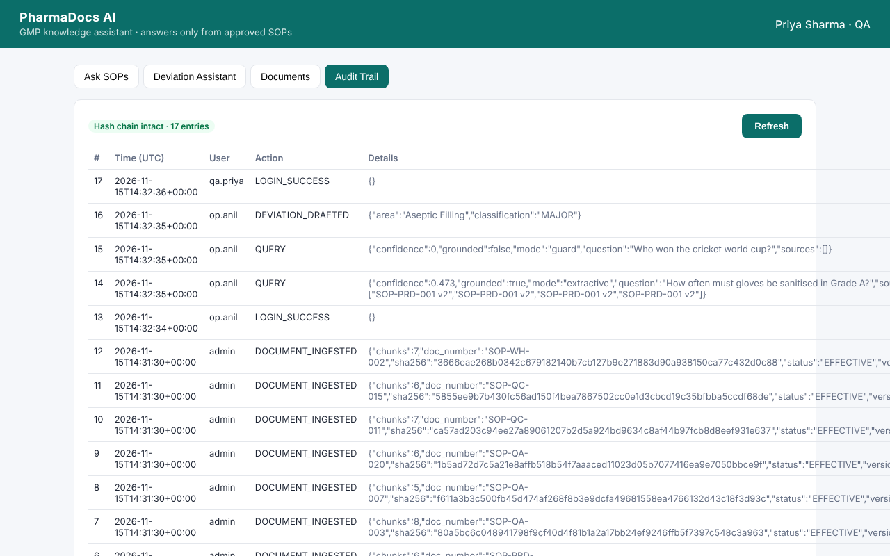

# PharmaDocs AI — GMP Knowledge Assistant with Audit Trail

> A retrieval-augmented (RAG) assistant that answers shop-floor and QA questions **only from approved, effective SOPs**, with section-level citations, role-based access and a tamper-evident audit trail inspired by **US FDA 21 CFR Part 11** and **EU GMP Annex 11**.

   



---

## Why this project

In a sterile injectable plant, operators, production and QA staff depend on hundreds of controlled documents — gowning, sterilization, environmental monitoring, deviation handling, line clearance. Finding the *right section of the right effective version* quickly is hard, and a generic chatbot is unacceptable in GMP because it can **hallucinate** or quote **obsolete** procedures.

PharmaDocs AI addresses this with:

| GMP need | How it is handled |
|---|---|
| Answer only from approved content | Retrieval is restricted to `EFFECTIVE` documents; obsolete versions are never searched |
| Traceability of every answer | Each statement is cited as `[SOP-ENG-004 v3 §7. Holding Time]` |
| No guessing | Confidence guard returns *"Not found in approved documents. Please contact QA."* |
| Need-to-know access | RBAC: Operator / Production / QA / Admin with document access levels |
| Data integrity (ALCOA+) | Append-only, SHA-256 **hash-chained** audit trail; DB triggers block edits; `/api/audit/verify` detects tampering |
| Version control | Uploading a new effective version automatically obsoletes the old one (logged) |
| Reason for change | Status changes require a reason (Part 11 style) |
| Routine workflow help | Deviation assistant drafts a structured deviation report (classification, impact, 5-Why, related SOPs, CAPA) for QA review |

---

## Architecture



**Project structure**

```
pharmadocs-ai/
├── app/
│   ├── __init__.py      # app factory, builds index at start-up
│   ├── auth.py          # JWT login, RBAC decorators, role → access-level map
│   ├── audit.py         # SHA-256 hash-chained audit trail + chain verification
│   ├── db.py            # schema (users, documents, chunks, audit_log, deviations) + triggers
│   ├── ingest.py        # PDF/DOCX/MD extraction, metadata, section chunking, versioning
│   ├── retriever.py     # BM25 + TF-IDF (+ dense) hybrid search with RRF, pharma synonyms, stemmer
│   ├── rag.py           # RAG pipeline, hallucination guard, offline extractive answerer
│   ├── llm.py           # OpenAI-compatible client (Groq / OpenAI / Ollama)
│   ├── deviation.py     # deviation report drafting (classification, 5-Why, CAPA)
│   ├── routes.py        # REST API
│   ├── cli.py           # `flask seed` – demo users + sample SOPs
│   └── templates/index.html   # single-page web UI
├── data/sops/           # 12 illustrative SOPs (incl. an obsolete version and QA-only / restricted docs)
├── eval/                # evaluation set (35 questions) + runner
├── tests/               # pytest suite (auth, RBAC, guard, versioning, deviation, audit tamper)
├── Dockerfile, docker-compose.yml, .github/workflows/ci.yml
```

---

## Quick start

```bash
git clone https://github.com/DabbetaThirupathi/pharmadocs-ai.git
cd pharmadocs-ai
python -m venv .venv && source .venv/bin/activate      # Windows: .venv\Scripts\activate
pip install -r requirements.txt
export FLASK_APP=app                                     # Windows: set FLASK_APP=app
flask seed                                               # demo users + 12 SOPs
python wsgi.py                                           # http://localhost:5000
```

Or with Docker:

```bash
docker compose up --build
```

**Demo logins**

| User | Password | Role | Sees |
|---|---|---|---|
| `op.anil` | `Oper@1234` | OPERATOR | general SOPs |
| `prod.ravi` | `Prod@1234` | PRODUCTION | general SOPs, deviation list |
| `qa.priya` | `Qa@12345` | QA | + QA-only docs, audit trail, upload |
| `admin` | `Admin@123` | ADMIN | everything incl. restricted IT SOPs |

### Optional: connect an LLM

The app runs **fully offline** using an extractive answerer. To generate fluent answers, set an OpenAI-compatible endpoint (Groq has a free tier):

```bash
export LLM_API_KEY=your_groq_key
export LLM_MODEL=llama-3.1-8b-instant
# local alternative: export LLM_BASE_URL=http://localhost:11434/v1 LLM_MODEL=llama3.1
```

The LLM receives only the retrieved passages and a strict system prompt (answer only from context, cite everything, otherwise say "Not found"). If the LLM call fails, the app falls back to the extractive answer.

---

## API

| Method | Endpoint | Roles | Purpose |
|---|---|---|---|
| POST | `/api/auth/login` | all | get JWT |
| POST | `/api/ask` | all | ask a question → answer, citations, confidence |
| GET | `/api/documents` | all (filtered) | list documents visible to the role |
| POST | `/api/documents` | QA, ADMIN | upload PDF/DOCX/MD (multipart) |
| POST | `/api/documents/<id>/status` | QA, ADMIN | change lifecycle status (reason required) |
| POST | `/api/deviations/draft` | all | draft a deviation report |
| GET | `/api/deviations` | PRODUCTION, QA, ADMIN | list deviations |
| GET | `/api/audit` | QA, ADMIN | audit trail |
| GET | `/api/audit/verify` | QA, ADMIN | verify hash chain integrity |
| POST | `/api/users` | ADMIN | create user |

Example:

```bash
TOKEN=$(curl -s -X POST localhost:5000/api/auth/login -H 'Content-Type: application/json' \
  -d '{"username":"op.anil","password":"Oper@1234"}' | python -c "import sys,json;print(json.load(sys.stdin)['token'])")
curl -s -X POST localhost:5000/api/ask -H "Authorization: Bearer $TOKEN" -H 'Content-Type: application/json' \
  -d '{"question":"How long can sterilised parts be held before use?"}'
```

```json
{
  "answer": "- To describe the operation of the double-door steam sterilizer used for sterilisation of filling machine parts, stoppers and garments. [SOP-ENG-004 v3 §1. Purpose]\n- Sterilised items must be used within 72 hours of sterilisation if the wrap remains intact. [SOP-ENG-004 v3 §7. Holding Time]",
  "grounded": true,
  "mode": "extractive",
  "confidence": 0.22,
  "citations": [{ "doc_number": "SOP-ENG-004", "version": 3, "section": "7. Holding Time", "...": "..." }]
}
```

---

## Evaluation

`python eval/run_eval.py` runs 35 questions: 30 answerable (one per SOP fact), 4 out-of-scope and 1 RBAC case (an operator asking about a QA-only SOP).

Results in **offline extractive mode** (no LLM):

| Metric | Score |
|---|---|
| Retrieval hit@1 | **1.00** |
| Retrieval hit@3 | **1.00** |
| Answer accuracy (key fact present) | **0.83** |
| Guard precision (out-of-scope / unauthorised refused) | **1.00** |
| Citation validity (cites only EFFECTIVE versions) | **1.00** |

Retrieval is perfect on this set. The remaining answer misses are procedural "what should I do" questions where the extractive answerer picks a related sentence; enabling an LLM addresses this. The evaluation runs in CI on every push.

---

## Screenshots

| | |
|---|---|
| **Out-of-scope question → refused**<br/> | **Deviation assistant draft**<br/> |
| **Document control (effective / obsolete versions)**<br/> | **Hash-chained audit trail**<br/> |

## Security & compliance notes

- Passwords hashed with Werkzeug (PBKDF2/scrypt); JWT with expiry; set a strong `SECRET_KEY` in production.
- Audit trail: append-only via SQLite triggers **and** cryptographically chained — even a direct DB edit that bypasses triggers is detected by `/api/audit/verify` (covered by tests).
- Every login (success/failure), query, upload, status change and deviation draft is logged with user and UTC timestamp.
- The deviation assistant **only drafts**; classification and closure remain QA decisions.
- This is a learning project. It demonstrates Part 11 / Annex 11 *concepts*; it is not a validated GxP system.

## Roadmap

- [ ] Electronic signatures (re-authentication + meaning of signature) on document approval
- [ ] Dense embeddings by default + cross-encoder re-ranking
- [ ] Multilingual answers (Telugu / Hindi) for shop-floor users
- [ ] PostgreSQL + Alembic migrations
- [ ] Integration with a QMS for deviation/CAPA hand-off

## Disclaimer

All SOPs in `data/sops/` are illustrative training documents written for this project and are not official procedures of any company.

## Author

**D. Thirupathi** — B.Tech Information Technology · [GitHub](https://github.com/DabbetaThirupathi)
